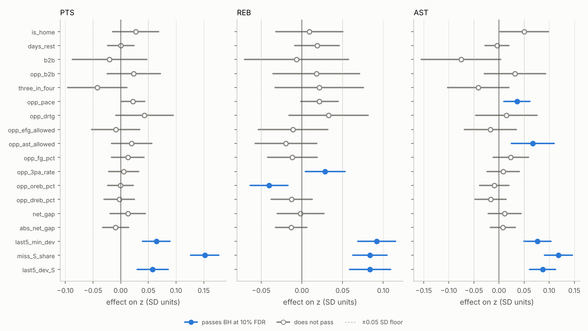
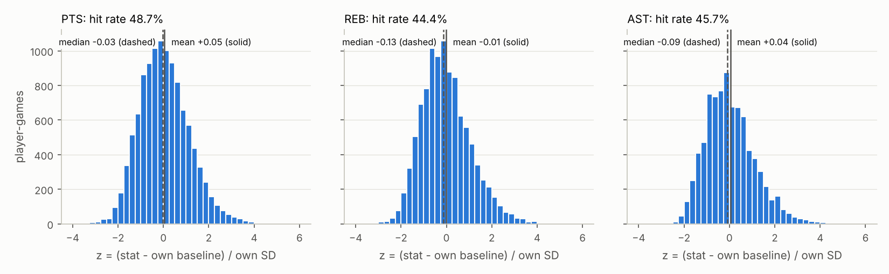
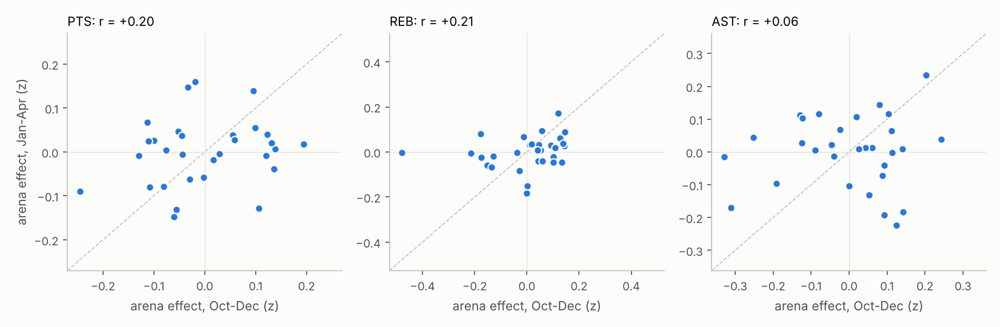

# Phase A: explore 2024-25

`nba-study-v1`, generated 2026-10-17 00:23 UTC by `analyze.py --phase explore` at commit `a450781`. Raw data: `2024-25_player.parquet` sha256 `5a22f197cf1e…`, `2024-25_team.parquet` sha256 `1b4a5052a887…`. All tests passed before this report was written.

Exploration only. 2025-26 has not been touched; it is looked at once, after the lock (§7-8).

## Summary

- **13 of 54** driver coefficients pass Benjamini-Hochberg at 10% FDR, and **10** of those also clear the proposed practical floor of |effect| ≥ 0.05 SD (lock candidates, table below).
- Arena, PTS: F(29, 259) = 1.37, p = 0.11; Oct-Dec vs. Jan-Apr effects correlate r = +0.20.
- Arena, REB: F(29, 252) = 1.46, p = 0.067; Oct-Dec vs. Jan-Apr effects correlate r = +0.21.
- Arena, AST: F(29, 215) = 2.11, p = 0.0014; Oct-Dec vs. Jan-Apr effects correlate r = +0.06.

### Lock candidates (pass BH and the floor)

| Stat | Driver | Direction | Effect on z [95% CI] | Hit-rate pts | Channel | Target |
|---|---|---|---|---|---|---|
| AST | `miss_AST_share` | + | +0.119 [+0.091, +0.146] | +3.61 | both | Per stat |
| AST | `last5_dev_AST` | + | +0.087 [+0.061, +0.113] | +3.93 | rate | Mean reversion vs. hot hand |
| AST | `last5_min_dev` | + | +0.077 [+0.049, +0.104] | +2.56 | minutes | Minutes |
| AST | `opp_ast_allowed` | + | +0.067 [+0.025, +0.110] | +2.48 | rate | AST |
| PTS | `miss_PTS_share` | + | +0.152 [+0.127, +0.177] | +5.43 | both | Per stat |
| PTS | `last5_min_dev` | + | +0.064 [+0.040, +0.089] | +2.77 | offsetting | Minutes |
| PTS | `last5_dev_PTS` | + | +0.058 [+0.030, +0.086] | +2.26 | rate | Mean reversion vs. hot hand |
| REB | `miss_REB_share` | + | +0.084 [+0.063, +0.105] | +3.16 | both | Per stat |
| REB | `last5_min_dev` | + | +0.092 [+0.069, +0.115] | +3.48 | minutes | Minutes |
| REB | `last5_dev_REB` | + | +0.084 [+0.059, +0.109] | +2.97 | both | Mean reversion vs. hot hand |

## How to read the driver tables

- **Effect on z**: the joint-model OLS coefficient. z is the game's stat minus the player's own stint baseline, in his own SDs. A continuous driver's effect is per 1 SD of that driver (its SD on the sample is shown beside it); a flag's effect is on vs. off. 95% CIs are clustered by player.
- **Hit-rate pts**: the logistic companion's average marginal effect on P(stat > baseline), in percentage points, per 1 SD or for the flag.
- **Minutes / SD**: the same design on `min_resid`, in minutes. **Rate (SD) / SD**: the same design on standardized `rate_resid_S` (games with MIN ≥ 10). * p < 0.05, ** p < 0.01. **Channel** names the one(s) with p < 0.05.
- **q (BH)** is the Benjamini-Hochberg adjusted p across all 54 driver coefficients in the three z models. **≥ floor** is |effect| ≥ 0.05 SD (the proposed practical floor; Juan confirms it at the lock).
- **Target** is the spec's hypothesis target for that feature (§5.3).

## PTS: ranked drivers

11,261 player-games, 260 players (rate model: 11,156 games with MIN ≥ 10). OLS R² = 0.035.

| # | Driver | Target | Effect on z [95% CI] | Hit-rate pts [95% CI] | Minutes / SD | Rate (SD) / SD | Channel | q (BH) | BH 10% | ≥ floor |
|---|---|---|---|---|---|---|---|---|---|---|
| 1 | `miss_PTS_share` (1 SD = 0.134) | Per stat | +0.152 [+0.127, +0.177] | +5.43 [+4.41, +6.44] | +0.82** | +0.087** | both | 0.000 | **yes** | yes |
| 2 | `last5_min_dev` (1 SD = 3.18) | Minutes | +0.064 [+0.040, +0.089] | +2.77 [+1.68, +3.87] | +1.67** | -0.063** | offsetting | 0.000 | **yes** | yes |
| 3 | `last5_dev_PTS` (1 SD = 0.46) | Mean reversion vs. hot hand | +0.058 [+0.030, +0.086] | +2.26 [+1.05, +3.47] | +0.08 | +0.057** | rate | 0.000 | **yes** | yes |
| 4 | `opp_drtg` (1 SD = 3.05) | PTS | +0.043 [-0.009, +0.095] | +0.96 [-1.42, +3.34] | -0.35* | +0.082** | offsetting | 0.310 | no | no |
| 5 | `three_in_four` (flag) | Minutes | -0.042 [-0.096, +0.011] | -0.26 [-2.75, +2.23] | -0.04 | -0.034 | neither | 0.343 | no | no |
| 6 | `is_home` (flag) | All | +0.027 [-0.014, +0.069] | +1.53 [-0.33, +3.39] | -0.09 | +0.034 | neither | 0.430 | no | no |
| 7 | `opp_b2b` (flag) | All | +0.024 [-0.024, +0.072] | -0.33 [-2.57, +1.91] | +0.14 | +0.021 | neither | 0.581 | no | no |
| 8 | `opp_pace` (1 SD = 1.86) | All | +0.022 [+0.002, +0.043] | +0.24 [-0.74, +1.22] | -0.25** | +0.049** | offsetting | 0.135 | no | no |
| 9 | `b2b` (flag) | Minutes | -0.020 [-0.087, +0.047] | -1.33 [-4.45, +1.80] | +0.32 | -0.040 | neither | 0.719 | no | no |
| 10 | `opp_ast_allowed` (1 SD = 1.4) | AST | +0.020 [-0.016, +0.056] | +0.70 [-0.97, +2.37] | +0.01 | +0.016 | neither | 0.580 | no | no |
| 11 | `net_gap` (1 SD = 7.4) | Minutes | +0.013 [-0.019, +0.045] | +0.43 [-0.84, +1.69] | +0.25** | -0.011 | minutes | 0.673 | no | no |
| 12 | `opp_fg_pct` (1 SD = 0.0166) | REB | +0.013 [-0.016, +0.042] | +0.23 [-1.08, +1.55] | +0.43** | -0.027 | minutes | 0.650 | no | no |
| 13 | `abs_net_gap` (1 SD = 4.38) | Minutes | -0.009 [-0.033, +0.014] | -0.78 [-1.77, +0.22] | -0.09 | -0.002 | neither | 0.673 | no | no |
| 14 | `opp_efg_allowed` (1 SD = 0.0131) | PTS, AST | -0.009 [-0.052, +0.035] | +0.05 [-1.88, +1.99] | +0.20 | -0.024 | neither | 0.793 | no | no |
| 15 | `opp_3pa_rate` (1 SD = 0.0342) | REB | +0.005 [-0.022, +0.032] | -0.45 [-1.68, +0.78] | +0.16* | -0.014 | minutes | 0.793 | no | no |
| 16 | `opp_dreb_pct` (1 SD = 0.0146) | REB | -0.003 [-0.030, +0.025] | -0.61 [-1.85, +0.63] | -0.02 | -0.007 | neither | 0.904 | no | no |
| 17 | `opp_oreb_pct` (1 SD = 0.024) | REB | -0.001 [-0.024, +0.023] | -0.10 [-1.22, +1.02] | +0.08 | -0.013 | neither | 0.974 | no | no |
| 18 | `days_rest` (1 SD = 1.05) | All | +0.000 [-0.023, +0.024] | -0.41 [-1.60, +0.78] | +0.05 | -0.003 | neither | 0.974 | no | no |

Usage swap: with `miss_usage_share` in place of `miss_PTS_share`, its effect is +0.151 [+0.126, +0.176], p = 1.8e-31.

## REB: ranked drivers

10,343 player-games, 253 players (rate model: 10,216 games with MIN ≥ 10). OLS R² = 0.030.

| # | Driver | Target | Effect on z [95% CI] | Hit-rate pts [95% CI] | Minutes / SD | Rate (SD) / SD | Channel | q (BH) | BH 10% | ≥ floor |
|---|---|---|---|---|---|---|---|---|---|---|
| 1 | `last5_min_dev` (1 SD = 3.2) | Minutes | +0.092 [+0.069, +0.115] | +3.48 [+2.25, +4.70] | +1.57** | -0.021 | minutes | 0.000 | **yes** | yes |
| 2 | `last5_dev_REB` (1 SD = 0.468) | Mean reversion vs. hot hand | +0.084 [+0.059, +0.109] | +2.97 [+1.77, +4.18] | +0.21** | +0.068** | both | 0.000 | **yes** | yes |
| 3 | `miss_REB_share` (1 SD = 0.123) | Per stat | +0.084 [+0.063, +0.105] | +3.16 [+2.09, +4.22] | +0.75** | +0.033** | both | 0.000 | **yes** | yes |
| 4 | `opp_oreb_pct` (1 SD = 0.0241) | REB | -0.040 [-0.063, -0.017] | -1.22 [-2.33, -0.10] | +0.11 | -0.047** | rate | 0.004 | **yes** | no |
| 5 | `opp_drtg` (1 SD = 3.05) | PTS | +0.033 [-0.016, +0.082] | +1.71 [-0.55, +3.96] | -0.25 | +0.064** | rate | 0.427 | no | no |
| 6 | `opp_3pa_rate` (1 SD = 0.0341) | REB | +0.028 [+0.004, +0.053] | +1.07 [-0.20, +2.34] | +0.22** | +0.011 | minutes | 0.091 | **yes** | no |
| 7 | `three_in_four` (flag) | Minutes | +0.022 [-0.033, +0.076] | +0.17 [-2.30, +2.65] | -0.12 | +0.018 | neither | 0.673 | no | no |
| 8 | `opp_pace` (1 SD = 1.86) | All | +0.022 [-0.001, +0.044] | +0.27 [-0.73, +1.27] | -0.22** | +0.035** | offsetting | 0.212 | no | no |
| 9 | `opp_ast_allowed` (1 SD = 1.41) | AST | -0.020 [-0.057, +0.018] | -0.65 [-2.39, +1.09] | -0.05 | -0.027 | neither | 0.580 | no | no |
| 10 | `days_rest` (1 SD = 1.05) | All | +0.019 [-0.009, +0.046] | +0.39 [-0.77, +1.56] | +0.04 | +0.015 | neither | 0.427 | no | no |
| 11 | `opp_b2b` (flag) | All | +0.018 [-0.035, +0.071] | +1.17 [-1.27, +3.62] | +0.06 | +0.026 | neither | 0.710 | no | no |
| 12 | `abs_net_gap` (1 SD = 4.41) | Minutes | -0.013 [-0.033, +0.006] | -0.26 [-1.20, +0.68] | -0.16* | +0.001 | minutes | 0.427 | no | no |
| 13 | `opp_dreb_pct` (1 SD = 0.0146) | REB | -0.013 [-0.038, +0.013] | -0.27 [-1.49, +0.95] | -0.02 | -0.019 | neither | 0.581 | no | no |
| 14 | `opp_fg_pct` (1 SD = 0.0166) | REB | -0.012 [-0.042, +0.019] | -0.22 [-1.72, +1.28] | +0.47** | -0.047** | offsetting | 0.673 | no | no |
| 15 | `opp_efg_allowed` (1 SD = 0.0131) | PTS, AST | -0.011 [-0.054, +0.032] | -0.42 [-2.48, +1.63] | +0.17 | -0.027 | neither | 0.755 | no | no |
| 16 | `is_home` (flag) | All | +0.009 [-0.032, +0.050] | +0.74 [-1.20, +2.67] | -0.15 | +0.010 | neither | 0.777 | no | no |
| 17 | `b2b` (flag) | Minutes | -0.007 [-0.071, +0.057] | +0.16 [-2.85, +3.17] | +0.37 | -0.044 | neither | 0.904 | no | no |
| 18 | `net_gap` (1 SD = 7.45) | Minutes | -0.002 [-0.030, +0.027] | -0.72 [-2.23, +0.79] | +0.23** | -0.012 | minutes | 0.944 | no | no |

Usage swap: with `miss_usage_share` in place of `miss_REB_share`, its effect is +0.074 [+0.051, +0.096], p = 1.3e-10.

## AST: ranked drivers

8,337 player-games, 216 players (rate model: 8,266 games with MIN ≥ 10). OLS R² = 0.039.

| # | Driver | Target | Effect on z [95% CI] | Hit-rate pts [95% CI] | Minutes / SD | Rate (SD) / SD | Channel | q (BH) | BH 10% | ≥ floor |
|---|---|---|---|---|---|---|---|---|---|---|
| 1 | `miss_AST_share` (1 SD = 0.133) | Per stat | +0.119 [+0.091, +0.146] | +3.61 [+2.47, +4.74] | +0.64** | +0.072** | both | 0.000 | **yes** | yes |
| 2 | `last5_dev_AST` (1 SD = 0.467) | Mean reversion vs. hot hand | +0.087 [+0.061, +0.113] | +3.93 [+2.64, +5.22] | +0.01 | +0.080** | rate | 0.000 | **yes** | yes |
| 3 | `last5_min_dev` (1 SD = 3.07) | Minutes | +0.077 [+0.049, +0.104] | +2.56 [+1.36, +3.76] | +1.60** | -0.022 | minutes | 0.000 | **yes** | yes |
| 4 | `b2b` (flag) | Minutes | -0.075 [-0.155, +0.004] | -2.52 [-6.25, +1.20] | +0.05 | -0.061 | neither | 0.209 | no | yes |
| 5 | `opp_ast_allowed` (1 SD = 1.4) | AST | +0.067 [+0.025, +0.110] | +2.48 [+0.49, +4.46] | -0.00 | +0.080** | rate | 0.009 | **yes** | yes |
| 6 | `is_home` (flag) | All | +0.050 [+0.002, +0.098] | +2.53 [+0.33, +4.73] | -0.23 | +0.065** | rate | 0.144 | no | yes |
| 7 | `three_in_four` (flag) | Minutes | -0.041 [-0.102, +0.020] | -0.74 [-3.67, +2.20] | +0.05 | -0.043 | neither | 0.427 | no | no |
| 8 | `opp_pace` (1 SD = 1.86) | All | +0.036 [+0.010, +0.062] | +2.10 [+0.96, +3.24] | -0.23** | +0.055** | offsetting | 0.030 | **yes** | no |
| 9 | `opp_b2b` (flag) | All | +0.032 [-0.030, +0.093] | +1.46 [-1.42, +4.34] | +0.11 | +0.019 | neither | 0.580 | no | no |
| 10 | `opp_fg_pct` (1 SD = 0.0166) | REB | +0.023 [-0.012, +0.058] | +0.82 [-0.82, +2.45] | +0.44** | -0.007 | minutes | 0.427 | no | no |
| 11 | `opp_efg_allowed` (1 SD = 0.013) | PTS, AST | -0.017 [-0.069, +0.035] | -0.43 [-2.76, +1.90] | +0.18 | -0.023 | neither | 0.710 | no | no |
| 12 | `opp_dreb_pct` (1 SD = 0.0146) | REB | -0.017 [-0.047, +0.014] | -0.68 [-2.05, +0.69] | -0.02 | -0.007 | neither | 0.580 | no | no |
| 13 | `opp_drtg` (1 SD = 3.04) | PTS | +0.015 [-0.046, +0.076] | +0.27 [-2.64, +3.18] | -0.29 | +0.023 | neither | 0.763 | no | no |
| 14 | `net_gap` (1 SD = 7.45) | Minutes | +0.011 [-0.022, +0.044] | +0.35 [-1.48, +2.18] | +0.16 | +0.009 | neither | 0.710 | no | no |
| 15 | `opp_oreb_pct` (1 SD = 0.0239) | REB | -0.009 [-0.038, +0.019] | -0.72 [-2.03, +0.60] | +0.04 | -0.021 | neither | 0.710 | no | no |
| 16 | `opp_3pa_rate` (1 SD = 0.0342) | REB | +0.009 [-0.023, +0.040] | +0.26 [-1.12, +1.65] | +0.20** | -0.005 | minutes | 0.753 | no | no |
| 17 | `abs_net_gap` (1 SD = 4.39) | Minutes | +0.008 [-0.017, +0.032] | +0.22 [-0.99, +1.44] | -0.14 | +0.021 | neither | 0.719 | no | no |
| 18 | `days_rest` (1 SD = 1.05) | All | -0.004 [-0.028, +0.020] | +0.16 [-1.06, +1.38] | +0.04 | -0.003 | neither | 0.836 | no | no |

Usage swap: with `miss_usage_share` in place of `miss_AST_share`, its effect is +0.102 [+0.075, +0.129], p = 1.8e-13.

## Base rates (§6.1)

Counting stats are right-skewed, so the hit rate sits below 50% and the median z below 0. Judge every factor against these base rates, not against 50%. Mean z sits slightly above 0 because eligibility admits players once their minutes reach 20 and a stint average trails a player who is improving; the joint models' intercept and season_phase absorb that level.

| Stat | Player-games | Players | Hit rate | Mean z | Median z | SD of z |
|---|---|---|---|---|---|---|
| PTS | 11,261 | 260 | 48.7% | +0.053 | -0.031 | 1.098 |
| REB | 10,343 | 253 | 44.4% | -0.012 | -0.126 | 1.087 |
| AST | 8,337 | 216 | 45.7% | +0.041 | -0.087 | 1.095 |

## Arena test (§6.5)

Arena fixed effects (home team's TEAM_ID, a proxy for the scorekeeper) added to each stat's joint model, deviation-coded so each effect is relative to the average arena. Joint Wald F-test with player-clustered SEs. Stability: the 30 effects estimated on Oct-Dec games vs. on Jan-Apr games. Expected: real for AST, possibly REB, null for PTS. A strong PTS effect would mean something else is wrong.

| Stat | F | df | p | r (Oct-Dec vs. Jan-Apr) | Spearman | Games early / late | Spread of effects (SD) |
|---|---|---|---|---|---|---|---|
| PTS | 1.37 | 29, 259 | 0.11 | +0.20 | +0.17 | 3,461 / 7,800 | 0.070 |
| REB | 1.46 | 29, 252 | 0.067 | +0.21 | +0.35 | 3,193 / 7,150 | 0.067 |
| AST | 2.11 | 29, 215 | 0.0014 | +0.06 | -0.04 | 2,546 / 5,791 | 0.093 |

- PTS: most generous arenas DET +0.129, SAS +0.122, MIN +0.106; stingiest BOS -0.151, BKN -0.119, TOR -0.105.
- REB: most generous arenas IND +0.139, CHA +0.102, NOP +0.085; stingiest PHX -0.119, OKC -0.119, DEN -0.108.
- AST: most generous arenas SAS +0.217, BKN +0.142, PHI +0.109; stingiest TOR -0.210, ORL -0.140, MIL -0.133.

## Sensitivity (§6.6)

Joint-model effects on z, rerun without OT games and without early exits (MIN < 0.5 × base_min). A sign flip is marked ⚠.

**PTS** (n: main 11,261, no OT 10,763, no early exits 11,021)

| Driver | Main | No OT games | No early exits |
|---|---|---|---|
| `is_home` | +0.027 | +0.023 | +0.027 |
| `days_rest` | +0.000 | +0.002 | -0.003 ⚠ |
| `b2b` | -0.020 | -0.029 | -0.038 |
| `opp_b2b` | +0.024 | +0.019 | +0.019 |
| `three_in_four` | -0.042 | -0.041 | -0.025 |
| `opp_pace` | +0.022 | +0.028 | +0.029 |
| `opp_drtg` | +0.043 | +0.040 | +0.043 |
| `opp_efg_allowed` | -0.009 | -0.012 | -0.009 |
| `opp_ast_allowed` | +0.020 | +0.023 | +0.019 |
| `opp_fg_pct` | +0.013 | +0.009 | +0.009 |
| `opp_3pa_rate` | +0.005 | +0.003 | +0.005 |
| `opp_oreb_pct` | -0.001 | -0.006 | -0.004 |
| `opp_dreb_pct` | -0.003 | -0.001 | -0.003 |
| `net_gap` | +0.013 | +0.017 | +0.007 |
| `abs_net_gap` | -0.009 | -0.010 | -0.012 |
| `last5_min_dev` (BH) | +0.064 | +0.063 | +0.048 |
| `miss_PTS_share` (BH) | +0.152 | +0.149 | +0.157 |
| `last5_dev_PTS` (BH) | +0.058 | +0.056 | +0.055 |

**REB** (n: main 10,343, no OT 9,887, no early exits 10,088)

| Driver | Main | No OT games | No early exits |
|---|---|---|---|
| `is_home` | +0.009 | +0.008 | +0.013 |
| `days_rest` | +0.019 | +0.011 | +0.017 |
| `b2b` | -0.007 | -0.036 | -0.022 |
| `opp_b2b` | +0.018 | -0.000 ⚠ | +0.014 |
| `three_in_four` | +0.022 | +0.023 | +0.039 |
| `opp_pace` | +0.022 | +0.025 | +0.026 |
| `opp_drtg` | +0.033 | +0.043 | +0.028 |
| `opp_efg_allowed` | -0.011 | -0.020 | -0.008 |
| `opp_ast_allowed` | -0.020 | -0.028 | -0.019 |
| `opp_fg_pct` | -0.012 | -0.013 | -0.017 |
| `opp_3pa_rate` (BH) | +0.028 | +0.024 | +0.026 |
| `opp_oreb_pct` (BH) | -0.040 | -0.049 | -0.044 |
| `opp_dreb_pct` | -0.013 | -0.010 | -0.014 |
| `net_gap` | -0.002 | +0.004 ⚠ | -0.009 |
| `abs_net_gap` | -0.013 | -0.013 | -0.015 |
| `last5_min_dev` (BH) | +0.092 | +0.093 | +0.074 |
| `miss_REB_share` (BH) | +0.084 | +0.083 | +0.087 |
| `last5_dev_REB` (BH) | +0.084 | +0.082 | +0.085 |

**AST** (n: main 8,337, no OT 7,960, no early exits 8,165)

| Driver | Main | No OT games | No early exits |
|---|---|---|---|
| `is_home` | +0.050 | +0.048 | +0.049 |
| `days_rest` | -0.004 | +0.004 ⚠ | -0.006 |
| `b2b` | -0.075 | -0.066 | -0.080 |
| `opp_b2b` | +0.032 | +0.028 | +0.033 |
| `three_in_four` | -0.041 | -0.042 | -0.038 |
| `opp_pace` (BH) | +0.036 | +0.038 | +0.037 |
| `opp_drtg` | +0.015 | +0.018 | +0.016 |
| `opp_efg_allowed` | -0.017 | -0.025 | -0.017 |
| `opp_ast_allowed` (BH) | +0.067 | +0.065 | +0.067 |
| `opp_fg_pct` | +0.023 | +0.018 | +0.020 |
| `opp_3pa_rate` | +0.009 | +0.009 | +0.007 |
| `opp_oreb_pct` | -0.009 | -0.011 | -0.012 |
| `opp_dreb_pct` | -0.017 | -0.015 | -0.018 |
| `net_gap` | +0.011 | +0.019 | +0.008 |
| `abs_net_gap` | +0.008 | +0.006 | +0.004 |
| `last5_min_dev` (BH) | +0.077 | +0.080 | +0.065 |
| `miss_AST_share` (BH) | +0.119 | +0.120 | +0.124 |
| `last5_dev_AST` (BH) | +0.087 | +0.082 | +0.085 |

## Model diagnostics

Variance inflation factors above 5 (shared variance makes those coefficients partial effects that are hard to separate):

- PTS `opp_drtg`: VIF 6.7
- REB `opp_drtg`: VIF 6.6
- AST `opp_drtg`: VIF 6.6

Highest VIFs per stat: PTS: `opp_drtg` 6.7, `opp_efg_allowed` 4.9, `opp_ast_allowed` 3.4; REB: `opp_drtg` 6.6, `opp_efg_allowed` 4.9, `opp_ast_allowed` 3.4; AST: `opp_drtg` 6.6, `opp_efg_allowed` 4.8, `opp_ast_allowed` 3.4.

## Choices made in this run (for review)

- **Teammate shares:** each stat's model carries its own `miss_S_share`; `miss_usage_share` is fit as a swap-in variant (reported under each table), because the two correlate at r = 0.995 (PTS), 0.94 (AST) and 0.91 (REB). The spec says "all features" (§6.3).
- **Channel models:** `min_resid` is fit on each stat's design and sample rather than once, so a driver's minutes and rate effects decompose the same model. The spec says once (§6.4); the common drivers' minutes effects are near-identical across the three fits.
- **BH family:** the driver coefficients of the three z models (54 tests). Logistic, channel, sensitivity and arena results are descriptive and not in the family. season_phase is a control and not in it either.
- **Standardization:** continuous drivers are z-scored within each model's sample; flags stay 0/1. **Inference:** Wald tests with player-clustered SEs, normal reference.
- **Neutral-site games** are never analysis rows (Juan, 2026-10-17); see `step1_findings.md`.
- **Fresh absences use the actual box score**: a late scratch isn't knowable before tip-off. Accepted for a drivers study (§5.3), but a live use would need injury reports.

## Appendix: one factor at a time (§6.2)

Each feature bucketed on its own (binary as-is, continuous in quintiles; ties can merge quintiles, and `days_rest` is bucketed by value: 0, 1, 2, 3+). Mean z and hit rate with 95% CIs clustered by player; **vs. base** is the bucket's hit rate minus the stat's overall hit rate, in points.

### PTS

**`is_home`**

| Bucket | n | Hit rate [95% CI] | vs. base | Mean z [95% CI] |
|---|---|---|---|---|
| 0 (no) | 5,611 | 48.0% [46.4, 49.5] | -0.7 | +0.041 [+0.006, +0.076] |
| 1 (yes) | 5,650 | 49.4% [47.9, 50.8] | +0.7 | +0.066 [+0.031, +0.100] |

**`days_rest`**

| Bucket | n | Hit rate [95% CI] | vs. base | Mean z [95% CI] |
|---|---|---|---|---|
| 0 | 1,986 | 49.0% [46.7, 51.4] | +0.4 | +0.056 [+0.002, +0.110] |
| 1 | 7,038 | 48.5% [47.1, 49.8] | -0.2 | +0.051 [+0.020, +0.082] |
| 2 | 1,532 | 50.8% [48.3, 53.4] | +2.2 | +0.076 [+0.017, +0.136] |
| 3+ | 705 | 45.0% [41.0, 48.9] | -3.7 | +0.023 [-0.059, +0.104] |

**`b2b`**

| Bucket | n | Hit rate [95% CI] | vs. base | Mean z [95% CI] |
|---|---|---|---|---|
| 0 (no) | 9,275 | 48.6% [47.3, 49.9] | -0.1 | +0.053 [+0.024, +0.082] |
| 1 (yes) | 1,986 | 49.0% [46.7, 51.4] | +0.4 | +0.056 [+0.002, +0.110] |

**`opp_b2b`**

| Bucket | n | Hit rate [95% CI] | vs. base | Mean z [95% CI] |
|---|---|---|---|---|
| 0 (no) | 9,184 | 48.7% [47.5, 49.9] | +0.0 | +0.049 [+0.020, +0.077] |
| 1 (yes) | 2,077 | 48.6% [46.4, 50.9] | -0.0 | +0.075 [+0.026, +0.125] |

**`three_in_four`**

| Bucket | n | Hit rate [95% CI] | vs. base | Mean z [95% CI] |
|---|---|---|---|---|
| 0 (no) | 8,312 | 48.5% [47.2, 49.8] | -0.2 | +0.057 [+0.027, +0.088] |
| 1 (yes) | 2,949 | 49.1% [47.2, 51.0] | +0.4 | +0.043 [-0.001, +0.087] |

**`opp_pace`**

| Bucket | n | Hit rate [95% CI] | vs. base | Mean z [95% CI] |
|---|---|---|---|---|
| Q1: 98.4 to 100 | 2,257 | 48.0% [45.8, 50.2] | -0.7 | +0.036 [-0.011, +0.084] |
| Q2: 100 to 101 | 2,251 | 46.8% [44.7, 48.8] | -1.9 | -0.030 [-0.076, +0.016] |
| Q3: 101 to 102 | 2,250 | 49.3% [47.0, 51.5] | +0.6 | +0.083 [+0.030, +0.136] |
| Q4: 102 to 103 | 2,257 | 49.7% [47.6, 51.8] | +1.0 | +0.078 [+0.030, +0.126] |
| Q5: 103 to 108 | 2,246 | 49.6% [47.4, 51.7] | +0.9 | +0.100 [+0.052, +0.149] |

**`opp_drtg`**

| Bucket | n | Hit rate [95% CI] | vs. base | Mean z [95% CI] |
|---|---|---|---|---|
| Q1: 102 to 108 | 2,255 | 44.6% [42.3, 46.9] | -4.1 | -0.064 [-0.117, -0.011] |
| Q2: 108 to 110 | 2,252 | 48.1% [45.9, 50.4] | -0.5 | +0.032 [-0.019, +0.083] |
| Q3: 110 to 112 | 2,251 | 49.2% [47.0, 51.4] | +0.6 | +0.074 [+0.027, +0.120] |
| Q4: 112 to 113 | 2,254 | 49.3% [47.1, 51.6] | +0.7 | +0.098 [+0.047, +0.149] |
| Q5: 113 to 117 | 2,249 | 52.1% [50.0, 54.2] | +3.4 | +0.129 [+0.081, +0.176] |

**`opp_efg_allowed`**

| Bucket | n | Hit rate [95% CI] | vs. base | Mean z [95% CI] |
|---|---|---|---|---|
| Q1: 0.501 to 0.53 | 2,255 | 45.8% [43.4, 48.3] | -2.9 | -0.027 [-0.080, +0.027] |
| Q2: 0.53 to 0.538 | 2,253 | 48.6% [46.4, 50.9] | -0.0 | +0.047 [-0.001, +0.096] |
| Q3: 0.538 to 0.544 | 2,254 | 48.8% [46.6, 51.0] | +0.1 | +0.061 [+0.012, +0.110] |
| Q4: 0.544 to 0.552 | 2,249 | 49.1% [47.0, 51.3] | +0.5 | +0.080 [+0.031, +0.129] |
| Q5: 0.552 to 0.571 | 2,250 | 51.0% [48.9, 53.1] | +2.3 | +0.107 [+0.058, +0.155] |

**`opp_ast_allowed`**

| Bucket | n | Hit rate [95% CI] | vs. base | Mean z [95% CI] |
|---|---|---|---|---|
| Q1: 21.1 to 24.5 | 2,254 | 45.2% [42.8, 47.5] | -3.5 | -0.046 [-0.097, +0.005] |
| Q2: 24.5 to 25.5 | 2,257 | 47.6% [45.4, 49.8] | -1.1 | +0.027 [-0.020, +0.073] |
| Q3: 25.5 to 26.2 | 2,248 | 48.8% [46.5, 51.1] | +0.1 | +0.052 [-0.001, +0.105] |
| Q4: 26.2 to 27 | 2,252 | 50.8% [48.8, 52.7] | +2.1 | +0.115 [+0.069, +0.160] |
| Q5: 27 to 28.6 | 2,250 | 51.0% [48.9, 53.1] | +2.4 | +0.120 [+0.070, +0.170] |

**`opp_fg_pct`**

| Bucket | n | Hit rate [95% CI] | vs. base | Mean z [95% CI] |
|---|---|---|---|---|
| Q1: 0.427 to 0.45 | 2,257 | 47.9% [45.8, 49.9] | -0.8 | +0.022 [-0.023, +0.067] |
| Q2: 0.45 to 0.46 | 2,253 | 50.3% [48.3, 52.4] | +1.7 | +0.102 [+0.056, +0.148] |
| Q3: 0.46 to 0.469 | 2,248 | 48.0% [45.8, 50.2] | -0.7 | +0.023 [-0.025, +0.070] |
| Q4: 0.469 to 0.479 | 2,253 | 48.6% [46.4, 50.7] | -0.1 | +0.058 [+0.008, +0.107] |
| Q5: 0.479 to 0.509 | 2,250 | 48.6% [46.3, 50.9] | -0.1 | +0.063 [+0.011, +0.115] |

**`opp_3pa_rate`**

| Bucket | n | Hit rate [95% CI] | vs. base | Mean z [95% CI] |
|---|---|---|---|---|
| Q1: 0.351 to 0.394 | 2,254 | 49.5% [47.3, 51.7] | +0.8 | +0.041 [-0.009, +0.090] |
| Q2: 0.394 to 0.407 | 2,254 | 48.4% [46.2, 50.7] | -0.2 | +0.048 [-0.002, +0.098] |
| Q3: 0.407 to 0.428 | 2,249 | 48.2% [46.1, 50.4] | -0.4 | +0.056 [+0.009, +0.103] |
| Q4: 0.429 to 0.448 | 2,252 | 50.2% [48.3, 52.2] | +1.6 | +0.106 [+0.061, +0.150] |
| Q5: 0.448 to 0.54 | 2,252 | 46.9% [44.7, 49.1] | -1.8 | +0.017 [-0.032, +0.066] |

**`opp_oreb_pct`**

| Bucket | n | Hit rate [95% CI] | vs. base | Mean z [95% CI] |
|---|---|---|---|---|
| Q1: 0.197 to 0.226 | 2,258 | 48.0% [45.7, 50.3] | -0.7 | +0.048 [-0.002, +0.099] |
| Q2: 0.226 to 0.244 | 2,249 | 49.7% [47.7, 51.7] | +1.0 | +0.058 [+0.016, +0.101] |
| Q3: 0.244 to 0.256 | 2,253 | 47.7% [45.6, 49.7] | -1.0 | +0.034 [-0.012, +0.081] |
| Q4: 0.256 to 0.27 | 2,254 | 49.4% [47.2, 51.6] | +0.8 | +0.078 [+0.028, +0.129] |
| Q5: 0.27 to 0.316 | 2,247 | 48.6% [46.3, 50.8] | -0.1 | +0.048 [-0.003, +0.099] |

**`opp_dreb_pct`**

| Bucket | n | Hit rate [95% CI] | vs. base | Mean z [95% CI] |
|---|---|---|---|---|
| Q1: 0.714 to 0.738 | 2,253 | 51.4% [49.3, 53.5] | +2.7 | +0.113 [+0.065, +0.162] |
| Q2: 0.738 to 0.747 | 2,255 | 49.5% [47.3, 51.8] | +0.9 | +0.066 [+0.016, +0.116] |
| Q3: 0.747 to 0.755 | 2,252 | 47.7% [45.5, 49.9] | -1.0 | +0.040 [-0.008, +0.088] |
| Q4: 0.755 to 0.763 | 2,251 | 47.7% [45.5, 49.9] | -1.0 | +0.031 [-0.018, +0.080] |
| Q5: 0.763 to 0.794 | 2,250 | 47.0% [45.0, 49.0] | -1.7 | +0.017 [-0.030, +0.063] |

**`net_gap`**

| Bucket | n | Hit rate [95% CI] | vs. base | Mean z [95% CI] |
|---|---|---|---|---|
| Q1: -21.7 to -6.13 | 2,255 | 47.3% [44.7, 49.9] | -1.3 | +0.027 [-0.030, +0.085] |
| Q2: -6.13 to -1.6 | 2,251 | 48.6% [46.4, 50.9] | -0.0 | +0.031 [-0.024, +0.086] |
| Q3: -1.58 to 2.17 | 2,251 | 49.1% [47.0, 51.2] | +0.4 | +0.059 [+0.010, +0.108] |
| Q4: 2.18 to 6.7 | 2,252 | 48.8% [46.6, 51.1] | +0.2 | +0.067 [+0.017, +0.117] |
| Q5: 6.71 to 21.7 | 2,252 | 49.4% [47.5, 51.4] | +0.8 | +0.084 [+0.034, +0.133] |

**`abs_net_gap`**

| Bucket | n | Hit rate [95% CI] | vs. base | Mean z [95% CI] |
|---|---|---|---|---|
| Q1: 0.000647 to 1.8 | 2,259 | 49.0% [46.8, 51.1] | +0.3 | +0.057 [+0.007, +0.107] |
| Q2: 1.8 to 3.97 | 2,246 | 49.2% [46.9, 51.5] | +0.5 | +0.048 [-0.004, +0.100] |
| Q3: 3.98 to 6.46 | 2,259 | 48.4% [46.3, 50.6] | -0.2 | +0.054 [+0.006, +0.102] |
| Q4: 6.47 to 9.77 | 2,256 | 47.9% [45.8, 50.0] | -0.7 | +0.027 [-0.020, +0.075] |
| Q5: 9.78 to 21.7 | 2,241 | 48.8% [46.5, 51.2] | +0.2 | +0.081 [+0.026, +0.136] |

**`last5_min_dev`**

| Bucket | n | Hit rate [95% CI] | vs. base | Mean z [95% CI] |
|---|---|---|---|---|
| Q1: -13.9 to -1.93 | 2,253 | 41.9% [39.7, 44.1] | -6.8 | -0.090 [-0.142, -0.038] |
| Q2: -1.92 to -0.3 | 2,256 | 47.4% [45.3, 49.5] | -1.2 | +0.022 [-0.027, +0.071] |
| Q3: -0.3 to 1.01 | 2,248 | 50.1% [48.0, 52.1] | +1.4 | +0.058 [+0.011, +0.106] |
| Q4: 1.02 to 2.72 | 2,252 | 50.0% [47.7, 52.3] | +1.3 | +0.091 [+0.039, +0.143] |
| Q5: 2.72 to 13.4 | 2,252 | 53.9% [51.6, 56.2] | +5.2 | +0.186 [+0.133, +0.239] |

**`miss_PTS_share`**

| Bucket | n | Hit rate [95% CI] | vs. base | Mean z [95% CI] |
|---|---|---|---|---|
| Q1: 0 to 0.12 | 6,760 | 44.8% [43.3, 46.2] | -3.9 | -0.056 [-0.089, -0.023] |
| Q2: 0.12 to 0.217 | 2,249 | 51.6% [49.2, 53.9] | +2.9 | +0.135 [+0.083, +0.187] |
| Q3: 0.218 to 0.901 | 2,252 | 57.4% [55.3, 59.4] | +8.7 | +0.300 [+0.247, +0.352] |

**`last5_dev_PTS`**

| Bucket | n | Hit rate [95% CI] | vs. base | Mean z [95% CI] |
|---|---|---|---|---|
| Q1: -1.88 to -0.333 | 2,253 | 44.1% [41.9, 46.2] | -4.6 | -0.065 [-0.117, -0.014] |
| Q2: -0.333 to -0.0685 | 2,252 | 45.4% [43.4, 47.5] | -3.2 | -0.014 [-0.062, +0.034] |
| Q3: -0.0682 to 0.177 | 2,252 | 48.5% [46.3, 50.7] | -0.2 | +0.053 [+0.007, +0.099] |
| Q4: 0.177 to 0.463 | 2,252 | 50.8% [48.6, 52.9] | +2.1 | +0.098 [+0.054, +0.142] |
| Q5: 0.463 to 1.79 | 2,252 | 54.6% [52.1, 57.0] | +5.9 | +0.195 [+0.138, +0.253] |

**`miss_usage_share`**

| Bucket | n | Hit rate [95% CI] | vs. base | Mean z [95% CI] |
|---|---|---|---|---|
| Q1: 0 to 0.121 | 6,760 | 44.8% [43.4, 46.3] | -3.8 | -0.053 [-0.086, -0.020] |
| Q2: 0.121 to 0.211 | 2,254 | 51.6% [49.2, 53.9] | +2.9 | +0.131 [+0.076, +0.186] |
| Q3: 0.212 to 0.913 | 2,247 | 57.3% [55.2, 59.4] | +8.6 | +0.297 [+0.243, +0.350] |

**`season_phase`**

| Bucket | n | Hit rate [95% CI] | vs. base | Mean z [95% CI] |
|---|---|---|---|---|
| Oct-Nov | 1,370 | 47.7% [45.0, 50.5] | -0.9 | +0.024 [-0.040, +0.087] |
| Dec | 2,091 | 46.9% [44.8, 49.0] | -1.7 | -0.003 [-0.053, +0.046] |
| Jan | 2,484 | 47.6% [45.3, 49.9] | -1.1 | +0.026 [-0.028, +0.079] |
| Feb | 1,802 | 48.6% [46.0, 51.3] | -0.1 | +0.065 [+0.002, +0.128] |
| Mar | 2,499 | 50.7% [48.3, 53.2] | +2.1 | +0.097 [+0.041, +0.152] |
| Apr | 1,015 | 51.1% [47.8, 54.5] | +2.5 | +0.152 [+0.074, +0.231] |

### REB

**`is_home`**

| Bucket | n | Hit rate [95% CI] | vs. base | Mean z [95% CI] |
|---|---|---|---|---|
| 0 (no) | 5,147 | 44.1% [42.4, 45.7] | -0.4 | -0.016 [-0.052, +0.020] |
| 1 (yes) | 5,196 | 44.8% [43.2, 46.4] | +0.4 | -0.007 [-0.042, +0.027] |

**`days_rest`**

| Bucket | n | Hit rate [95% CI] | vs. base | Mean z [95% CI] |
|---|---|---|---|---|
| 0 | 1,833 | 45.0% [42.5, 47.5] | +0.6 | -0.008 [-0.064, +0.047] |
| 1 | 6,444 | 44.2% [42.7, 45.7] | -0.3 | -0.018 [-0.050, +0.015] |
| 2 | 1,421 | 44.6% [41.7, 47.6] | +0.2 | -0.010 [-0.069, +0.050] |
| 3+ | 645 | 45.1% [41.3, 49.0] | +0.7 | +0.035 [-0.055, +0.126] |

**`b2b`**

| Bucket | n | Hit rate [95% CI] | vs. base | Mean z [95% CI] |
|---|---|---|---|---|
| 0 (no) | 8,510 | 44.3% [43.0, 45.7] | -0.1 | -0.012 [-0.042, +0.017] |
| 1 (yes) | 1,833 | 45.0% [42.5, 47.5] | +0.6 | -0.008 [-0.064, +0.047] |

**`opp_b2b`**

| Bucket | n | Hit rate [95% CI] | vs. base | Mean z [95% CI] |
|---|---|---|---|---|
| 0 (no) | 8,445 | 44.2% [42.8, 45.6] | -0.3 | -0.015 [-0.046, +0.016] |
| 1 (yes) | 1,898 | 45.6% [43.2, 47.9] | +1.1 | +0.003 [-0.048, +0.055] |

**`three_in_four`**

| Bucket | n | Hit rate [95% CI] | vs. base | Mean z [95% CI] |
|---|---|---|---|---|
| 0 (no) | 7,617 | 44.2% [42.8, 45.7] | -0.2 | -0.018 [-0.049, +0.013] |
| 1 (yes) | 2,726 | 45.0% [43.0, 47.1] | +0.6 | +0.006 [-0.044, +0.056] |

**`opp_pace`**

| Bucket | n | Hit rate [95% CI] | vs. base | Mean z [95% CI] |
|---|---|---|---|---|
| Q1: 98.4 to 100 | 2,069 | 44.2% [42.0, 46.4] | -0.3 | -0.036 [-0.085, +0.013] |
| Q2: 100 to 101 | 2,070 | 43.8% [41.5, 46.0] | -0.7 | -0.029 [-0.081, +0.022] |
| Q3: 101 to 102 | 2,071 | 45.5% [43.0, 48.0] | +1.0 | +0.015 [-0.037, +0.067] |
| Q4: 102 to 103 | 2,065 | 44.2% [42.0, 46.5] | -0.2 | -0.007 [-0.058, +0.044] |
| Q5: 103 to 108 | 2,068 | 44.6% [42.2, 47.0] | +0.1 | -0.001 [-0.053, +0.052] |

**`opp_drtg`**

| Bucket | n | Hit rate [95% CI] | vs. base | Mean z [95% CI] |
|---|---|---|---|---|
| Q1: 102 to 108 | 2,073 | 42.3% [39.9, 44.6] | -2.2 | -0.068 [-0.118, -0.018] |
| Q2: 108 to 110 | 2,068 | 46.9% [44.6, 49.1] | +2.4 | +0.018 [-0.034, +0.070] |
| Q3: 110 to 112 | 2,068 | 43.7% [41.4, 45.9] | -0.8 | -0.001 [-0.050, +0.047] |
| Q4: 112 to 113 | 2,065 | 43.7% [41.3, 46.0] | -0.8 | -0.025 [-0.078, +0.029] |
| Q5: 113 to 117 | 2,069 | 45.8% [43.5, 48.1] | +1.3 | +0.018 [-0.030, +0.066] |

**`opp_efg_allowed`**

| Bucket | n | Hit rate [95% CI] | vs. base | Mean z [95% CI] |
|---|---|---|---|---|
| Q1: 0.501 to 0.53 | 2,069 | 43.7% [41.4, 46.0] | -0.8 | -0.045 [-0.097, +0.007] |
| Q2: 0.53 to 0.538 | 2,072 | 44.9% [42.7, 47.2] | +0.5 | +0.026 [-0.022, +0.074] |
| Q3: 0.538 to 0.544 | 2,066 | 43.8% [41.4, 46.2] | -0.6 | -0.040 [-0.090, +0.010] |
| Q4: 0.544 to 0.552 | 2,069 | 47.0% [44.5, 49.5] | +2.5 | +0.037 [-0.019, +0.093] |
| Q5: 0.552 to 0.571 | 2,067 | 42.8% [40.6, 45.0] | -1.6 | -0.037 [-0.084, +0.010] |

**`opp_ast_allowed`**

| Bucket | n | Hit rate [95% CI] | vs. base | Mean z [95% CI] |
|---|---|---|---|---|
| Q1: 21.1 to 24.5 | 2,071 | 43.0% [40.7, 45.3] | -1.5 | -0.052 [-0.103, -0.001] |
| Q2: 24.5 to 25.5 | 2,069 | 45.4% [43.1, 47.7] | +1.0 | +0.021 [-0.032, +0.075] |
| Q3: 25.5 to 26.1 | 2,069 | 45.7% [43.4, 48.0] | +1.3 | +0.009 [-0.041, +0.060] |
| Q4: 26.2 to 27 | 2,065 | 44.1% [41.8, 46.3] | -0.4 | -0.005 [-0.052, +0.043] |
| Q5: 27 to 28.6 | 2,069 | 44.0% [41.7, 46.4] | -0.4 | -0.032 [-0.083, +0.020] |

**`opp_fg_pct`**

| Bucket | n | Hit rate [95% CI] | vs. base | Mean z [95% CI] |
|---|---|---|---|---|
| Q1: 0.427 to 0.45 | 2,069 | 43.4% [40.9, 45.8] | -1.1 | -0.030 [-0.081, +0.021] |
| Q2: 0.45 to 0.46 | 2,073 | 45.4% [43.3, 47.6] | +1.0 | +0.009 [-0.038, +0.056] |
| Q3: 0.46 to 0.469 | 2,067 | 44.5% [42.3, 46.7] | +0.1 | +0.007 [-0.041, +0.055] |
| Q4: 0.469 to 0.479 | 2,069 | 44.8% [42.3, 47.3] | +0.4 | -0.010 [-0.065, +0.045] |
| Q5: 0.479 to 0.509 | 2,065 | 44.1% [41.7, 46.5] | -0.3 | -0.034 [-0.089, +0.022] |

**`opp_3pa_rate`**

| Bucket | n | Hit rate [95% CI] | vs. base | Mean z [95% CI] |
|---|---|---|---|---|
| Q1: 0.351 to 0.394 | 2,069 | 42.0% [39.6, 44.4] | -2.4 | -0.075 [-0.127, -0.023] |
| Q2: 0.394 to 0.407 | 2,068 | 44.1% [41.9, 46.4] | -0.3 | -0.028 [-0.078, +0.022] |
| Q3: 0.407 to 0.428 | 2,069 | 44.3% [41.9, 46.7] | -0.1 | -0.007 [-0.061, +0.047] |
| Q4: 0.428 to 0.448 | 2,069 | 47.2% [45.0, 49.4] | +2.7 | +0.056 [+0.010, +0.102] |
| Q5: 0.448 to 0.54 | 2,068 | 44.6% [42.3, 46.9] | +0.1 | -0.003 [-0.055, +0.048] |

**`opp_oreb_pct`**

| Bucket | n | Hit rate [95% CI] | vs. base | Mean z [95% CI] |
|---|---|---|---|---|
| Q1: 0.197 to 0.226 | 2,073 | 45.8% [43.3, 48.3] | +1.3 | +0.037 [-0.018, +0.092] |
| Q2: 0.226 to 0.244 | 2,067 | 45.2% [43.1, 47.4] | +0.8 | +0.008 [-0.037, +0.054] |
| Q3: 0.244 to 0.256 | 2,071 | 44.7% [42.5, 46.9] | +0.3 | -0.008 [-0.061, +0.044] |
| Q4: 0.256 to 0.27 | 2,067 | 43.2% [40.7, 45.7] | -1.2 | -0.060 [-0.110, -0.011] |
| Q5: 0.27 to 0.316 | 2,065 | 43.3% [41.0, 45.5] | -1.2 | -0.035 [-0.082, +0.013] |

**`opp_dreb_pct`**

| Bucket | n | Hit rate [95% CI] | vs. base | Mean z [95% CI] |
|---|---|---|---|---|
| Q1: 0.714 to 0.738 | 2,074 | 44.6% [42.4, 46.9] | +0.2 | -0.002 [-0.048, +0.045] |
| Q2: 0.738 to 0.747 | 2,064 | 45.3% [43.1, 47.5] | +0.9 | +0.004 [-0.048, +0.056] |
| Q3: 0.747 to 0.755 | 2,071 | 43.4% [40.9, 45.8] | -1.1 | -0.034 [-0.085, +0.017] |
| Q4: 0.755 to 0.763 | 2,067 | 43.8% [41.5, 46.0] | -0.7 | -0.002 [-0.055, +0.051] |
| Q5: 0.763 to 0.794 | 2,067 | 45.1% [42.7, 47.6] | +0.7 | -0.025 [-0.075, +0.025] |

**`net_gap`**

| Bucket | n | Hit rate [95% CI] | vs. base | Mean z [95% CI] |
|---|---|---|---|---|
| Q1: -21.7 to -6.12 | 2,069 | 45.3% [42.7, 47.9] | +0.9 | -0.006 [-0.061, +0.049] |
| Q2: -6.11 to -1.56 | 2,070 | 44.4% [42.1, 46.8] | -0.0 | -0.031 [-0.084, +0.023] |
| Q3: -1.55 to 2.29 | 2,067 | 44.8% [42.5, 47.0] | +0.3 | +0.023 [-0.027, +0.073] |
| Q4: 2.3 to 6.85 | 2,072 | 44.4% [42.2, 46.6] | -0.0 | -0.024 [-0.074, +0.026] |
| Q5: 6.85 to 21.7 | 2,065 | 43.3% [40.8, 45.8] | -1.2 | -0.021 [-0.071, +0.030] |

**`abs_net_gap`**

| Bucket | n | Hit rate [95% CI] | vs. base | Mean z [95% CI] |
|---|---|---|---|---|
| Q1: 0.000647 to 1.81 | 2,076 | 44.7% [42.4, 46.9] | +0.2 | +0.020 [-0.032, +0.072] |
| Q2: 1.84 to 3.98 | 2,061 | 43.2% [41.0, 45.5] | -1.2 | -0.061 [-0.112, -0.011] |
| Q3: 3.98 to 6.48 | 2,078 | 46.1% [43.7, 48.5] | +1.7 | +0.020 [-0.034, +0.074] |
| Q4: 6.49 to 9.87 | 2,062 | 44.0% [41.5, 46.6] | -0.4 | -0.023 [-0.076, +0.029] |
| Q5: 9.89 to 21.7 | 2,066 | 44.2% [42.0, 46.4] | -0.3 | -0.014 [-0.061, +0.033] |

**`last5_min_dev`**

| Bucket | n | Hit rate [95% CI] | vs. base | Mean z [95% CI] |
|---|---|---|---|---|
| Q1: -13.9 to -2 | 2,079 | 37.0% [34.5, 39.4] | -7.5 | -0.204 [-0.258, -0.149] |
| Q2: -2 to -0.348 | 2,058 | 44.1% [41.9, 46.2] | -0.4 | -0.038 [-0.084, +0.009] |
| Q3: -0.348 to 0.967 | 2,072 | 43.8% [41.5, 46.1] | -0.6 | -0.022 [-0.069, +0.024] |
| Q4: 0.968 to 2.64 | 2,065 | 44.6% [42.3, 47.0] | +0.2 | -0.001 [-0.051, +0.050] |
| Q5: 2.64 to 15.4 | 2,069 | 52.7% [50.3, 55.2] | +8.3 | +0.207 [+0.155, +0.260] |

**`miss_REB_share`**

| Bucket | n | Hit rate [95% CI] | vs. base | Mean z [95% CI] |
|---|---|---|---|---|
| Q1: 0 to 0.105 | 6,208 | 41.9% [40.4, 43.5] | -2.5 | -0.070 [-0.104, -0.036] |
| Q2: 0.105 to 0.198 | 2,071 | 45.4% [43.0, 47.8] | +1.0 | -0.005 [-0.054, +0.044] |
| Q3: 0.198 to 0.85 | 2,064 | 51.0% [48.6, 53.5] | +6.6 | +0.157 [+0.104, +0.210] |

**`last5_dev_REB`**

| Bucket | n | Hit rate [95% CI] | vs. base | Mean z [95% CI] |
|---|---|---|---|---|
| Q1: -1.52 to -0.394 | 2,069 | 37.7% [35.4, 39.9] | -6.8 | -0.195 [-0.247, -0.143] |
| Q2: -0.394 to -0.145 | 2,068 | 42.2% [40.0, 44.4] | -2.3 | -0.083 [-0.128, -0.038] |
| Q3: -0.144 to 0.107 | 2,069 | 42.8% [40.6, 45.1] | -1.6 | -0.024 [-0.069, +0.022] |
| Q4: 0.107 to 0.409 | 2,068 | 48.5% [46.0, 51.0] | +4.1 | +0.064 [+0.011, +0.117] |
| Q5: 0.409 to 1.79 | 2,069 | 51.1% [48.5, 53.7] | +6.6 | +0.179 [+0.120, +0.238] |

**`miss_usage_share`**

| Bucket | n | Hit rate [95% CI] | vs. base | Mean z [95% CI] |
|---|---|---|---|---|
| Q1: 0 to 0.122 | 6,206 | 42.9% [41.3, 44.6] | -1.5 | -0.063 [-0.099, -0.028] |
| Q2: 0.123 to 0.214 | 2,069 | 43.8% [41.5, 46.1] | -0.7 | +0.005 [-0.049, +0.059] |
| Q3: 0.214 to 0.913 | 2,068 | 49.6% [47.1, 52.2] | +5.2 | +0.127 [+0.074, +0.180] |

**`season_phase`**

| Bucket | n | Hit rate [95% CI] | vs. base | Mean z [95% CI] |
|---|---|---|---|---|
| Oct-Nov | 1,286 | 44.9% [41.7, 48.2] | +0.5 | -0.013 [-0.083, +0.057] |
| Dec | 1,907 | 43.8% [41.3, 46.4] | -0.6 | -0.013 [-0.074, +0.048] |
| Jan | 2,303 | 43.5% [41.1, 45.9] | -0.9 | -0.029 [-0.084, +0.025] |
| Feb | 1,654 | 45.7% [42.5, 48.9] | +1.3 | +0.018 [-0.054, +0.089] |
| Mar | 2,280 | 43.9% [41.2, 46.6] | -0.5 | -0.027 [-0.085, +0.031] |
| Apr | 913 | 46.4% [42.7, 50.2] | +2.0 | +0.023 [-0.065, +0.111] |

### AST

**`is_home`**

| Bucket | n | Hit rate [95% CI] | vs. base | Mean z [95% CI] |
|---|---|---|---|---|
| 0 (no) | 4,150 | 44.6% [42.9, 46.2] | -1.1 | +0.019 [-0.020, +0.058] |
| 1 (yes) | 4,187 | 46.8% [44.8, 48.8] | +1.1 | +0.062 [+0.021, +0.103] |

**`days_rest`**

| Bucket | n | Hit rate [95% CI] | vs. base | Mean z [95% CI] |
|---|---|---|---|---|
| 0 | 1,463 | 44.4% [41.6, 47.1] | -1.3 | -0.002 [-0.062, +0.057] |
| 1 | 5,222 | 46.3% [44.7, 48.0] | +0.6 | +0.052 [+0.014, +0.091] |
| 2 | 1,128 | 44.0% [40.9, 47.0] | -1.7 | +0.047 [-0.023, +0.117] |
| 3+ | 524 | 46.8% [42.7, 50.8] | +1.1 | +0.032 [-0.051, +0.115] |

**`b2b`**

| Bucket | n | Hit rate [95% CI] | vs. base | Mean z [95% CI] |
|---|---|---|---|---|
| 0 (no) | 6,874 | 46.0% [44.4, 47.6] | +0.3 | +0.050 [+0.015, +0.084] |
| 1 (yes) | 1,463 | 44.4% [41.6, 47.1] | -1.3 | -0.002 [-0.062, +0.057] |

**`opp_b2b`**

| Bucket | n | Hit rate [95% CI] | vs. base | Mean z [95% CI] |
|---|---|---|---|---|
| 0 (no) | 6,815 | 45.4% [43.9, 47.0] | -0.3 | +0.035 [+0.002, +0.067] |
| 1 (yes) | 1,522 | 47.0% [44.2, 49.8] | +1.3 | +0.068 [+0.003, +0.133] |

**`three_in_four`**

| Bucket | n | Hit rate [95% CI] | vs. base | Mean z [95% CI] |
|---|---|---|---|---|
| 0 (no) | 6,160 | 45.9% [44.2, 47.5] | +0.2 | +0.050 [+0.016, +0.084] |
| 1 (yes) | 2,177 | 45.2% [42.7, 47.6] | -0.5 | +0.013 [-0.040, +0.067] |

**`opp_pace`**

| Bucket | n | Hit rate [95% CI] | vs. base | Mean z [95% CI] |
|---|---|---|---|---|
| Q1: 98.4 to 100 | 1,668 | 45.2% [42.4, 48.0] | -0.5 | +0.028 [-0.029, +0.084] |
| Q2: 100 to 101 | 1,672 | 41.7% [39.1, 44.3] | -4.0 | -0.046 [-0.102, +0.011] |
| Q3: 101 to 102 | 1,662 | 44.2% [41.5, 46.9] | -1.5 | -0.000 [-0.059, +0.058] |
| Q4: 102 to 103 | 1,670 | 46.8% [44.4, 49.2] | +1.1 | +0.082 [+0.029, +0.135] |
| Q5: 103 to 108 | 1,665 | 50.6% [48.2, 53.0] | +4.9 | +0.140 [+0.085, +0.194] |

**`opp_drtg`**

| Bucket | n | Hit rate [95% CI] | vs. base | Mean z [95% CI] |
|---|---|---|---|---|
| Q1: 102 to 108 | 1,670 | 42.2% [39.5, 44.9] | -3.5 | -0.072 [-0.131, -0.013] |
| Q2: 108 to 110 | 1,667 | 43.6% [40.8, 46.3] | -2.1 | -0.002 [-0.061, +0.058] |
| Q3: 110 to 112 | 1,669 | 45.2% [42.6, 47.7] | -0.5 | +0.043 [-0.013, +0.099] |
| Q4: 112 to 113 | 1,665 | 47.9% [45.1, 50.6] | +2.2 | +0.097 [+0.034, +0.160] |
| Q5: 113 to 117 | 1,666 | 49.7% [47.2, 52.2] | +4.0 | +0.137 [+0.078, +0.196] |

**`opp_efg_allowed`**

| Bucket | n | Hit rate [95% CI] | vs. base | Mean z [95% CI] |
|---|---|---|---|---|
| Q1: 0.501 to 0.53 | 1,669 | 43.9% [41.1, 46.6] | -1.8 | -0.039 [-0.098, +0.021] |
| Q2: 0.53 to 0.538 | 1,667 | 45.5% [42.9, 48.0] | -0.2 | +0.038 [-0.018, +0.094] |
| Q3: 0.538 to 0.544 | 1,668 | 44.8% [42.1, 47.4] | -0.9 | +0.055 [-0.005, +0.114] |
| Q4: 0.544 to 0.552 | 1,669 | 46.2% [43.6, 48.8] | +0.5 | +0.033 [-0.024, +0.090] |
| Q5: 0.552 to 0.571 | 1,664 | 48.2% [45.5, 50.9] | +2.5 | +0.116 [+0.055, +0.178] |

**`opp_ast_allowed`**

| Bucket | n | Hit rate [95% CI] | vs. base | Mean z [95% CI] |
|---|---|---|---|---|
| Q1: 21.1 to 24.5 | 1,669 | 41.1% [38.5, 43.7] | -4.6 | -0.089 [-0.147, -0.031] |
| Q2: 24.5 to 25.5 | 1,667 | 44.8% [42.3, 47.2] | -0.9 | +0.032 [-0.022, +0.087] |
| Q3: 25.5 to 26.1 | 1,666 | 43.9% [41.2, 46.7] | -1.8 | +0.001 [-0.058, +0.060] |
| Q4: 26.1 to 27 | 1,668 | 49.0% [46.2, 51.8] | +3.3 | +0.111 [+0.047, +0.174] |
| Q5: 27 to 28.6 | 1,667 | 49.7% [47.1, 52.4] | +4.0 | +0.149 [+0.087, +0.210] |

**`opp_fg_pct`**

| Bucket | n | Hit rate [95% CI] | vs. base | Mean z [95% CI] |
|---|---|---|---|---|
| Q1: 0.427 to 0.45 | 1,672 | 42.2% [39.9, 44.4] | -3.5 | -0.014 [-0.068, +0.039] |
| Q2: 0.45 to 0.46 | 1,666 | 46.8% [44.1, 49.4] | +1.1 | +0.049 [-0.009, +0.107] |
| Q3: 0.46 to 0.469 | 1,664 | 47.7% [45.1, 50.2] | +2.0 | +0.057 [-0.001, +0.115] |
| Q4: 0.469 to 0.479 | 1,668 | 45.0% [42.5, 47.5] | -0.7 | +0.048 [-0.013, +0.108] |
| Q5: 0.479 to 0.509 | 1,667 | 46.9% [44.3, 49.5] | +1.2 | +0.064 [+0.006, +0.121] |

**`opp_3pa_rate`**

| Bucket | n | Hit rate [95% CI] | vs. base | Mean z [95% CI] |
|---|---|---|---|---|
| Q1: 0.351 to 0.394 | 1,670 | 44.7% [42.2, 47.3] | -1.0 | +0.016 [-0.039, +0.072] |
| Q2: 0.394 to 0.407 | 1,666 | 46.5% [44.0, 49.0] | +0.8 | +0.058 [+0.004, +0.112] |
| Q3: 0.407 to 0.429 | 1,668 | 45.4% [42.8, 48.1] | -0.3 | +0.033 [-0.027, +0.093] |
| Q4: 0.429 to 0.449 | 1,669 | 48.8% [46.3, 51.3] | +3.1 | +0.093 [+0.042, +0.144] |
| Q5: 0.449 to 0.54 | 1,664 | 43.0% [40.2, 45.8] | -2.7 | +0.003 [-0.055, +0.061] |

**`opp_oreb_pct`**

| Bucket | n | Hit rate [95% CI] | vs. base | Mean z [95% CI] |
|---|---|---|---|---|
| Q1: 0.197 to 0.226 | 1,670 | 47.5% [45.0, 49.9] | +1.8 | +0.071 [+0.020, +0.122] |
| Q2: 0.226 to 0.244 | 1,668 | 45.5% [43.0, 48.0] | -0.2 | +0.032 [-0.023, +0.088] |
| Q3: 0.244 to 0.256 | 1,666 | 46.0% [43.1, 48.9] | +0.3 | +0.038 [-0.024, +0.100] |
| Q4: 0.256 to 0.27 | 1,667 | 45.5% [42.8, 48.1] | -0.2 | +0.052 [-0.002, +0.107] |
| Q5: 0.27 to 0.316 | 1,666 | 44.1% [41.6, 46.5] | -1.6 | +0.010 [-0.046, +0.065] |

**`opp_dreb_pct`**

| Bucket | n | Hit rate [95% CI] | vs. base | Mean z [95% CI] |
|---|---|---|---|---|
| Q1: 0.714 to 0.738 | 1,669 | 47.7% [45.4, 50.0] | +2.0 | +0.097 [+0.044, +0.151] |
| Q2: 0.738 to 0.747 | 1,667 | 48.7% [46.1, 51.3] | +3.0 | +0.098 [+0.040, +0.156] |
| Q3: 0.747 to 0.755 | 1,670 | 46.2% [43.5, 48.9] | +0.5 | +0.041 [-0.015, +0.098] |
| Q4: 0.755 to 0.763 | 1,663 | 43.2% [40.4, 45.9] | -2.5 | -0.005 [-0.064, +0.054] |
| Q5: 0.763 to 0.794 | 1,668 | 42.7% [40.2, 45.2] | -3.0 | -0.029 [-0.086, +0.029] |

**`net_gap`**

| Bucket | n | Hit rate [95% CI] | vs. base | Mean z [95% CI] |
|---|---|---|---|---|
| Q1: -21.7 to -6.31 | 1,672 | 45.6% [42.6, 48.5] | -0.1 | +0.038 [-0.026, +0.101] |
| Q2: -6.29 to -1.67 | 1,666 | 44.3% [41.5, 47.1] | -1.4 | -0.007 [-0.072, +0.059] |
| Q3: -1.67 to 2.09 | 1,665 | 44.8% [42.1, 47.6] | -0.9 | +0.025 [-0.033, +0.083] |
| Q4: 2.11 to 6.68 | 1,666 | 46.0% [43.2, 48.8] | +0.3 | +0.044 [-0.017, +0.105] |
| Q5: 6.68 to 21.7 | 1,668 | 47.8% [45.1, 50.6] | +2.1 | +0.103 [+0.047, +0.159] |

**`abs_net_gap`**

| Bucket | n | Hit rate [95% CI] | vs. base | Mean z [95% CI] |
|---|---|---|---|---|
| Q1: 0.000647 to 1.85 | 1,674 | 44.3% [41.6, 46.9] | -1.4 | +0.017 [-0.040, +0.074] |
| Q2: 1.87 to 4.05 | 1,662 | 46.0% [43.2, 48.7] | +0.3 | +0.014 [-0.052, +0.079] |
| Q3: 4.07 to 6.48 | 1,672 | 44.6% [41.8, 47.4] | -1.1 | +0.024 [-0.032, +0.081] |
| Q4: 6.49 to 9.87 | 1,666 | 47.9% [45.5, 50.3] | +2.2 | +0.078 [+0.022, +0.134] |
| Q5: 9.89 to 21.7 | 1,663 | 45.8% [43.1, 48.6] | +0.1 | +0.070 [+0.014, +0.125] |

**`last5_min_dev`**

| Bucket | n | Hit rate [95% CI] | vs. base | Mean z [95% CI] |
|---|---|---|---|---|
| Q1: -13.9 to -1.76 | 1,668 | 39.9% [36.8, 43.1] | -5.8 | -0.124 [-0.188, -0.060] |
| Q2: -1.76 to -0.217 | 1,667 | 43.4% [40.8, 46.0] | -2.3 | -0.020 [-0.074, +0.034] |
| Q3: -0.216 to 1.01 | 1,667 | 47.7% [45.1, 50.2] | +2.0 | +0.070 [+0.014, +0.126] |
| Q4: 1.01 to 2.61 | 1,667 | 45.4% [43.0, 47.8] | -0.3 | +0.064 [+0.008, +0.120] |
| Q5: 2.61 to 13.4 | 1,668 | 52.1% [49.3, 54.9] | +6.4 | +0.214 [+0.148, +0.280] |

**`miss_AST_share`**

| Bucket | n | Hit rate [95% CI] | vs. base | Mean z [95% CI] |
|---|---|---|---|---|
| Q1: 0 to 0.104 | 5,004 | 43.4% [41.7, 45.2] | -2.3 | -0.036 [-0.073, +0.002] |
| Q2: 0.104 to 0.217 | 1,666 | 47.5% [45.0, 49.9] | +1.8 | +0.069 [+0.011, +0.126] |
| Q3: 0.217 to 0.891 | 1,667 | 50.7% [47.9, 53.6] | +5.0 | +0.241 [+0.174, +0.308] |

**`last5_dev_AST`**

| Bucket | n | Hit rate [95% CI] | vs. base | Mean z [95% CI] |
|---|---|---|---|---|
| Q1: -1.45 to -0.341 | 1,668 | 37.7% [35.0, 40.5] | -8.0 | -0.149 [-0.202, -0.097] |
| Q2: -0.341 to -0.0693 | 1,667 | 46.3% [43.8, 48.8] | +0.6 | +0.037 [-0.018, +0.092] |
| Q3: -0.0693 to 0.176 | 1,667 | 43.9% [41.5, 46.3] | -1.8 | +0.014 [-0.041, +0.069] |
| Q4: 0.176 to 0.458 | 1,667 | 48.4% [45.8, 50.9] | +2.7 | +0.105 [+0.051, +0.160] |
| Q5: 0.458 to 1.85 | 1,668 | 52.3% [49.1, 55.4] | +6.6 | +0.196 [+0.126, +0.266] |

**`miss_usage_share`**

| Bucket | n | Hit rate [95% CI] | vs. base | Mean z [95% CI] |
|---|---|---|---|---|
| Q1: 0 to 0.119 | 5,005 | 43.4% [41.7, 45.1] | -2.3 | -0.035 [-0.071, +0.002] |
| Q2: 0.119 to 0.208 | 1,666 | 47.8% [45.1, 50.5] | +2.1 | +0.117 [+0.054, +0.180] |
| Q3: 0.208 to 0.913 | 1,666 | 50.6% [47.8, 53.4] | +4.9 | +0.190 [+0.123, +0.257] |

**`season_phase`**

| Bucket | n | Hit rate [95% CI] | vs. base | Mean z [95% CI] |
|---|---|---|---|---|
| Oct-Nov | 1,007 | 46.7% [43.0, 50.4] | +1.0 | +0.038 [-0.040, +0.115] |
| Dec | 1,539 | 43.8% [40.7, 46.8] | -1.9 | +0.001 [-0.066, +0.068] |
| Jan | 1,815 | 45.3% [42.5, 48.1] | -0.4 | +0.006 [-0.053, +0.064] |
| Feb | 1,328 | 45.3% [42.0, 48.7] | -0.4 | +0.025 [-0.052, +0.102] |
| Mar | 1,886 | 47.0% [44.3, 49.8] | +1.3 | +0.094 [+0.028, +0.160] |
| Apr | 762 | 46.5% [42.3, 50.6] | +0.8 | +0.104 [+0.007, +0.201] |

